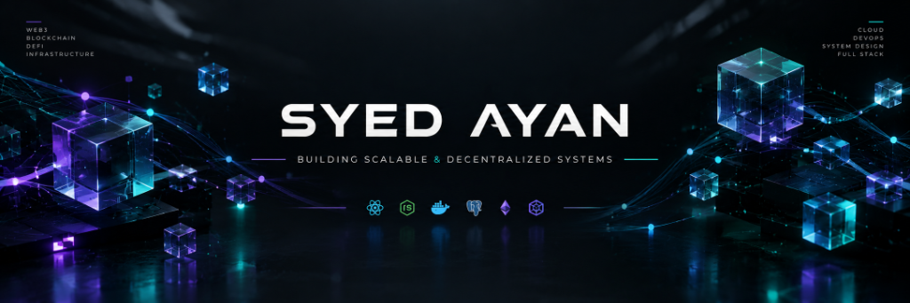

 

# Syed Ayan

**Computer Science Student** &middot; **Data Science Specialization** &middot; **Full Stack & ML Enthusiast**

Undergraduate studying Computer Science (Data Science) &bull; Exploring Machine Learning, Data Analytics, Scalable Systems & Open Source

 

 

> *"learning. failing. improving. repeating. every line of code tells a story."*

---

## 🎓 About Me & Academic Journey

I am an undergraduate student pursuing **Computer Science with a specialization in Data Science (CS-DS)**. I am passionate about understanding data patterns, building predictive models, and bridging the gap between **data science, machine learning, and scalable software systems**.

As a student, I believe the best way to master computer science is by building real, end-to-end applications—applying theoretical mathematics, statistics, and algorithms directly to practical problems.

### 🔬 What I'm Focused On
- **Data Science & Machine Learning:** Exploratory Data Analysis (EDA), statistical modeling, feature engineering, and predictive pipelines with Scikit-Learn and Python.
- **Data Engineering & Analytics:** High-performance columnar querying with DuckDB, dbt SQL transformations, and Parquet data pipelines.
- **Full-Stack Development:** Building robust web backends with FastAPI and Node.js, coupled with clean, interactive user interfaces in React.
- **Applied Algorithms & Systems:** Implementing core Data Structures & Algorithms (DSA), distributed IoT architectures, and exploring Web3 technologies.

 

---

## 🚀 Featured Projects & Academic Builds

A showcase of hands-on data science pipelines, analytical tools, and full-stack software built throughout my studies:

### 1. Data Science & Columnar Analytics

#### 📊 **[Telecom Churn Data Warehouse](https://github.com/SyedAynan/telecom-churn-dw)** &mdash; *Sub-12ms Columnar Analytics & ML Pipeline*
> **Tech:** `DuckDB 1.3.2` &middot; `dbt 1.12.5` &middot; `Python 3.12` &middot; `Scikit-Learn` &middot; `Streamlit` &middot; `Parquet` &middot; `GNU Make` &middot; `uv`
- **Sub-12ms Query Latency:** Columnar analytics engine built on DuckDB, executing aggregations over millions of rows in milliseconds.
- **End-to-End Orchestration:** Automated single-command lifecycle (`make all`): raw ETL &rarr; dbt compilation &rarr; ML training &rarr; batch scoring &rarr; warehouse updates.
- **Data Quality & Testing:** Verified with **43 dbt model test assertions** + **39 pytest unit tests** passing with 100% test coverage.
- **Streaming Telemetry Simulator:** Real-time carrier signal simulator (Jio, Airtel, Vi, BSNL) joined directly with customer risk scoring.
- **Interactive Dashboard:** Responsive Streamlit interface with animated count-up KPI tiles, factor coefficient waterfall breakdowns, and live risk queues.

---

### 2. Algorithmic Systems & FinTech

#### 🏦 **[Nexus Bank](https://github.com/SyedAynan/Nexus-Bank)** &mdash; *Full-Stack Digital Banking & AML Compliance Platform*
> **Tech:** `FastAPI` &middot; `React 18` &middot; `PostgreSQL` &middot; `Vite` &middot; `Docker` &middot; `WebSockets` &middot; `Python` &middot; `Machine Learning`
- **Fraud Intelligence:** Integrated machine learning fraud detection model alongside Anti-Money Laundering (AML) graph analytics for detecting suspicious transaction rings.
- **DSA Execution Engines:** Built around 7 native Data Structures & Algorithms (DSA) execution engines for transaction scheduling, graph traversals, and ledger reconciliation.
- **Architecture & Security:** Digital banking interface with multi-factor authentication (JWT + MFA) and 5-role Role-Based Access Control (RBAC).
- **Real-Time Telemetry:** Live bidirectional WebSocket stream powering live transaction approvals and audit trails.
- **Containerization:** Multi-stage Docker setup for reproducible local development and deployment parity.

---

### 3. Edge Computing & Healthcare IoT

#### 🏥 **[Patient Monitoring Mesh](https://github.com/SyedAynan/Patient-monitoring-mesh)** &mdash; *Edge-Intelligence Healthcare Mesh Network*
> **Tech:** `Python 3.10+` &middot; `TypeScript` &middot; `FastAPI` &middot; `React / Next.js` &middot; `SQLite` &middot; `HMAC-SHA256` &middot; `Capacitor (Android)`
- **Edge Risk Engine:** Rule-based clinical triage scoring executed locally on edge nodes and identically on the backend to prevent score drift.
- **Store-and-Forward Resilience:** Self-healing routing topology with automatic rerouting to alternate relays during simulated network partitions.
- **Cryptographic Security:** Gateway-level HMAC-SHA256 frame verification ensuring payload integrity.
- **Testing & Verification:** Validated through **249 comprehensive tests** and a 40-session recorded experimental evaluation run.
- **Cross-Platform Client:** Desktop app, installable Progressive Web App (PWA), and Android build via Capacitor.

---

### 4. Interactive Simulation & Graphics

#### ⚓ **[Master of Chios](https://github.com/SyedAynan/Master-of-Chios)** &mdash; *Aegean Maritime & Economic Simulation Engine*
> **Tech:** `HTML5 Canvas 2D` &middot; `Vanilla JavaScript (ES Modules)` &middot; `Vite` &middot; `Web Audio API` &middot; `CSS3 Glassmorphism`
- **60 FPS Canvas Physics:** Custom 2D HTML5 Canvas engine rendering real-time ship movement, trade routes, and dynamic weather physics.
- **Economic Simulator:** Dynamic supply-and-demand market simulation modeling fluctuating prices for commodities across Mediterranean ports.
- **Procedural Sound Engine:** Zero-dependency audio synthesizer using Web Audio API for environmental soundscapes and sound effects.

---

### 5. Campus & Automation Platforms

#### 🎓 **[Neural Feedback (FacultyLens)](https://github.com/SyedAynan/Neural-Feedback)** &mdash; *Anonymous Academic Evaluation & Analytics*
> **Tech:** `PHP` &middot; `MySQL` &middot; `JavaScript` &middot; `HTML5 / CSS3`
- **Privacy-Preserving Surveys:** Decoupled student identity submission ensuring 100% candid academic and faculty feedback.
- **Analytics & Dashboards:** Aggregate rating scoring, sentiment trend visualization, and department-level evaluation metrics.

#### 🚗 **[Smart Parking Management System](https://github.com/SyedAynan/Smart-Parking-Management-System)** &mdash; *Intelligent Facility Automation*
> **Tech:** `Python` &middot; `JavaScript` &middot; `HTML5 / CSS3` &middot; `Makefile`
- **Automated Space Allocation:** Algorithmic bay assignment maximizing facility space utilization.
- **Real-Time Telemetry:** Occupancy tracking and live slot availability visualization.

 

---

## 🧪 Project Benchmarks & Testing Standards

| Project | Metric / Scope | Academic Goal | Achieved Result | Status |
| :--- | :--- | :---: | :---: | :---: |
| **Patient Monitoring Mesh** | Automated Unit & Integration Suite | Comprehensive Coverage | **249 Tests Passing** | :white_check_mark: Green |
| **Telecom Churn DW** | dbt Model Assertions & Data Integrity | Enterprise Rigor | **43 Assertions Passing** | :white_check_mark: 100% Validated |
| **Telecom Churn DW** | Pytest Test Suite | Full Pipeline Coverage | **39 / 39 Passing** | :white_check_mark: Green |
| **Telecom Churn DW** | DuckDB Analytical Query Latency | Sub-second OLAP | **`< 12 ms`** | :zap: High Performance |
| **Nexus Bank** | Native DSA Execution Engines | Algorithmic Implementation | **7 Algorithms Implemented** | :white_check_mark: Implemented |
| **Master of Chios** | Canvas Animation & Physics Loop | Smooth Simulation | **60 FPS Smooth** | :white_check_mark: Zero-lag Loop |
| **Patient Monitoring Mesh** | Gateway Frame Security | Integrity Verification | **HMAC-SHA256 Enforced** | :lock: Verified |

 

---

## 🛠️ Technical Toolkit

### Data Science, Machine Learning & Analytics

### Programming Languages

### Web Development & Systems

### Developer Tools & Workflow

 

---

## 📈 GitHub Activity

  <picture>
    <source media="(prefers-color-scheme: dark)" srcset="https://raw.githubusercontent.com/SyedAynan/SyedAynan/output/github-snake-dark.svg" />
    <source media="(prefers-color-scheme: light)" srcset="https://raw.githubusercontent.com/SyedAynan/SyedAynan/output/github-snake.svg" />
    
  </picture>

 

---

## 📬 Let's Connect!

I'm always keen to connect with fellow students, developers, researchers, and mentors. Whether you want to talk about Data Science, Machine Learning, Open Source, or discuss collaboration opportunities and internships:

&nbsp;&nbsp;

&nbsp;&nbsp;

 

---

  Crafted with curiosity by <b>Syed Ayan</b> &middot; CS (Data Science) Student &middot; Always Learning & Building

