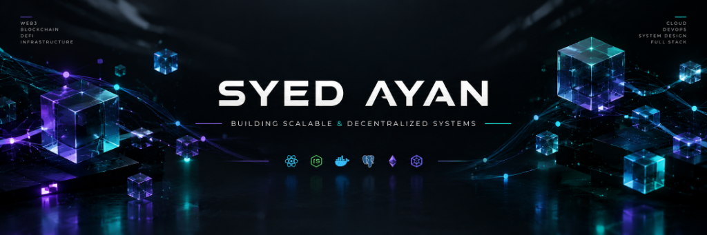

 
 

 

 

> *"Turning theoretical data science, deep learning models, and complex mathematics into resilient, real-time software systems."*

---

## ⚡ High-Impact Engineering Benchmarks

A quantitative snapshot across my flagship research implementations and systems:

| Flagship System | Metric & Core Architecture | Benchmark / Verified Result | Verification Standard |
| :--- | :--- | :---: | :---: |
| 🧠 **[NeuroScan AI](#1-clinical-intelligence--neuro-oncology)** | 3D Volumetric Brain Tumor Segmentation (BraTS 4-sequence) | **0.815 Mean Validation Dice** | MONAI 3D U-Net + MC-Dropout |
| ⚡ **[Telecom Churn DW](#3-high-performance-columnar-analytics)** | Analytical Columnar OLAP Query Latency | **`< 12 ms`** | DuckDB 1.3.2 + dbt 1.12.5 |
| 🛡️ **[Patient Monitoring Mesh](#5-distributed-systems--edge-iot)** | Multi-patient Edge Network Resilience & Unit Test Suite | **249 Tests Passing** | HMAC-SHA256 Frame Cryptography |
| 🔍 **[DeepWatch](#2-multimodal-ai-forensics)** | Multimodal Deepfake Forensics & Generation Attribution | **ICCV 2023 Evidence Standard** | Multimodal Spatial-Frequency Probes |
| 🏦 **[Nexus Bank](#4-fintech-systems--financial-crime-intelligence)** | Native DSA Algorithms & AML Transaction Graph Engine | **7 Execution Engines** | Automated Ring Traversal & Scoring |
| ⚓ **[Master of Chios](#6-interactive-simulation--canvas-engines)** | 2D Canvas Physics, Dynamic Economy & Sound Synthesis | **60 FPS Fixed-Step Loop** | Web Audio API + Zero-lag Canvas |

 

---

## 🚀 Featured Flagship Projects

### 🧠 Medical AI & Computer Vision

#### 1. **[NeuroScan AI](https://github.com/SyedAynan/NeuroScan-AI)** &mdash; *Autonomous Clinical Intelligence & 3D Neuro-Oncology Pipeline*
> **Stack:** `PyTorch 2.5+` &middot; `MONAI 1.3+` &middot; `3D U-Net` &middot; `FastAPI` &middot; `Three.js (WebGL)` &middot; `Monte Carlo Dropout` &middot; `Grad-CAM`
- **Volumetric 3D Tumor Segmentation:** End-to-end segmentation of 4-channel multi-sequence MRI (`FLAIR`, `T1w`, `t1gd`, `T2w`) into Whole Tumor, Tumor Core, and Enhancing Tumor sub-compartments with **0.815 Mean Validation Dice**.
- **Epistemic Uncertainty Quantification:** Integrated voxel-level Monte Carlo Dropout inference mapping model confidence to alert neurosurgeons to ambiguous boundaries.
- **Explainable AI (Grad-CAM):** Feature attribution maps localizing radiological decision weightings directly onto 3D anatomical planes.
- **Multimodal Clinical IoMT:** Integrated bedside ocular pupillometry telemetry and active reinforcement learning triage engines.
- **Interactive 3D Digital Twin:** Real-time Three.js WebGL volume visualizer with cross-sectional multi-planar slicing (Axial, Coronal, Sagittal).

---

#### 2. **[DeepWatch](https://github.com/SyedAynan/DeepWatch)** &mdash; *Unified Deepfake Forensics & Generative Attribution Platform*
> **Stack:** `Python 3.11+` &middot; `PyTorch` &middot; `OpenCV` &middot; `TorchVision` &middot; `FastAPI` &middot; `React` &middot; `uv` &middot; `Docker`
- **Forensic Attribution Engine:** Multimodal deepfake forensic laboratory implementing modern vision architectures (based on IEEE/CVF ICCV 2023 methodologies) to detect AI manipulation and attribute generation origins (GAN vs. Diffusion).
- **Dual-Domain Analysis:** Evaluates spatial pixel inconsistencies, blended boundary artifacts, and frequency-domain spectral anomalies (FFT analysis).
- **Chain-of-Custody Integrity:** Forensic audit logging ensuring tamper-proof image evidence records for journalistic and regulatory verification.

---

### 📊 Data Engineering & Columnar Analytics

#### 3. **[Telecom Churn Data Warehouse](https://github.com/SyedAynan/telecom-churn-dw)** &mdash; *Sub-12ms Columnar OLAP & Machine Learning Engine*
> **Stack:** `DuckDB 1.3.2` &middot; `dbt 1.12.5` &middot; `Python 3.12` &middot; `Scikit-Learn` &middot; `Streamlit` &middot; `Apache Parquet` &middot; `GNU Make` &middot; `uv`
- **Sub-12ms Columnar Query Execution:** Ultra-low latency analytical warehouse built on DuckDB, executing aggregations over millions of rows with microsecond-level vectorization.
- **End-to-End Orchestrated Pipeline:** Single-command lifecycle (`make all`): raw ingestion &rarr; dbt SQL transforms &rarr; predictive model training &rarr; batch inference scoring.
- **Zero-Tolerance Quality Verification:** Validated with **43 dbt model test assertions** + **39 Pytest unit tests** with 100% data model coverage.
- **Live Carrier Telemetry:** Realistic real-time signal stream (Jio, Airtel, Vi, BSNL) coupled with factor coefficient waterfall breakdowns on Streamlit.

---

### 🏦 FinTech & Financial Crime Intelligence

#### 4. **[Nexus Bank](https://github.com/SyedAynan/Nexus-Bank)** &mdash; *Enterprise Digital Banking & AML Compliance Platform*
> **Stack:** `FastAPI` &middot; `React 18` &middot; `PostgreSQL` &middot; `WebSockets` &middot; `Docker` &middot; `Machine Learning` &middot; `Tailwind CSS`
- **AML Graph Intelligence:** Anti-Money Laundering graph analysis detecting cyclical transfer patterns, smurfing rings, and high-velocity mule accounts.
- **7 Native DSA Execution Engines:** Built around custom algorithmic engines for transaction scheduling (priority heaps), ledger reconciliation, and fraud pattern detection.
- **Real-Time WebSockets:** Live bidirectional financial stream powering instantaneous compliance approvals and live audit trails.
- **Enterprise Security:** Multi-factor authentication (JWT + MFA) with 5-tier Role-Based Access Control (RBAC).

---

### 🏥 Distributed Systems & Edge IoT

#### 5. **[Patient Monitoring Mesh](https://github.com/SyedAynan/Patient-monitoring-mesh)** &mdash; *Edge-Intelligence Healthcare Mesh Network*
> **Stack:** `Python 3.10+` &middot; `TypeScript` &middot; `FastAPI` &middot; `React / Next.js` &middot; `SQLite` &middot; `HMAC-SHA256` &middot; `Capacitor`
- **Edge Clinical Triage:** Decentralized rule-based patient acuity scoring executed directly on edge sensor nodes without server latency.
- **Store-and-Forward Resilience:** Self-healing mesh routing topology with automatic message store-and-forwarding during network partitions.
- **Cryptographic Security:** Gateway-level HMAC-SHA256 signature verification preventing packet tampering and spoofing.
- **Rigorously Tested:** Verified across **249 comprehensive tests** and a 40-session empirical trial run.

---

### ⚓ Simulation & Web Engines

#### 6. **[Master of Chios](https://github.com/SyedAynan/Master-of-Chios)** &mdash; *Aegean Maritime & Economic Simulation Engine*
> **Stack:** `HTML5 Canvas 2D` &middot; `Vanilla JavaScript (ES Modules)` &middot; `Vite` &middot; `Web Audio API` &middot; `CSS3 Glassmorphism`
- **60 FPS Canvas Physics:** Custom 2D physics and rendering loop modeling trade routes, wind vectors, and maritime dynamics.
- **Dynamic Port Economy:** Non-linear supply-and-demand microeconomic algorithm fluctuating commodity pricing across 12 Mediterranean ports.
- **Procedural Audio Synthesizer:** Zero-dependency soundscape synthesized programmatically via the Web Audio API.

 

---

## 🛠️ Technical Arsenal

### AI, Machine Learning & Deep Learning

### Data Engineering & Analytics

### Systems, Web & 3D Graphics

### Languages & Core Tooling

 

---

## 📊 Live GitHub Analytics

&nbsp;

 
 

### 🐍 Contribution Activity Graph

<picture>
  <source media="(prefers-color-scheme: dark)" srcset="https://raw.githubusercontent.com/SyedAynan/SyedAynan/output/github-snake-dark.svg" />
  <source media="(prefers-color-scheme: light)" srcset="https://raw.githubusercontent.com/SyedAynan/SyedAynan/output/github-snake.svg" />
  
</picture>

 

---

## 📬 Let's Connect & Collaborate

Whether you're interested in discussing **Medical AI**, **Columnar Data Engineering**, **Applied Machine Learning**, or exploring collaboration opportunities:

&nbsp;&nbsp;

&nbsp;&nbsp;

 

---

## ⚖️ Copyright, Attribution & Academic Integrity

**Copyright (c) 2026 Syed Ayan. All rights reserved.**

> ### 🎓 Notice Regarding Original Engineering & Plagiarism
> This profile and repository contain original architectures, statistical pipelines, and code authored by **Syed Ayan**.
>
> - **Technical Review & Evaluation:** Publicly viewable for recruiter exploration, prospective technical evaluation, and academic critique.
> - **Prohibition of Plagiarized Submissions:** Direct duplication, unauthorized mirroring, or passing off of original project architectures or implementation code for institutional academic grading or commercial distribution without written consent is strictly prohibited.
> - **Trademarks & Dependencies:** All respective open-source licenses, trademarks, and third-party badges belong to their respective owners.

 

  Crafted with precision by <b>Syed Ayan</b> &middot; CS (Data Science) Student &middot; Always Learning, Always Building

